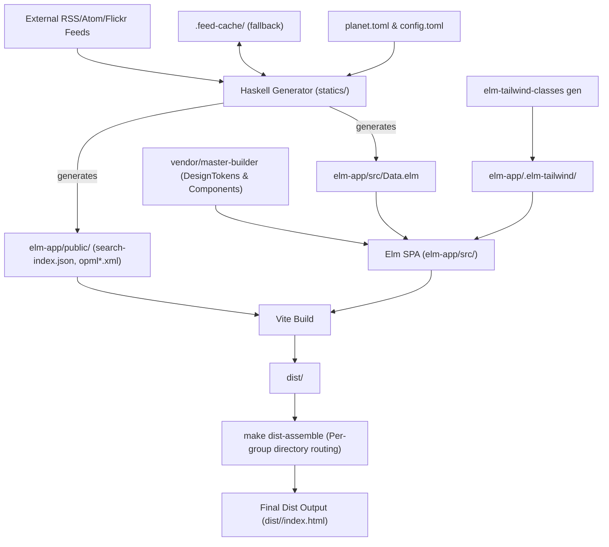

# AGENTS.md — Planet (Suomen Palikkaharrastajat Feed Aggregator)

This document contains authoritative development instructions, architecture details, build/test workflows, and change rules for AI coding agents working on the `planet` project.

---

## 1. Project Overview & Role in the Ecosystem

`planet` is the official community feed aggregator and static web portal for **Suomen Palikkaharrastajat ry** (the Finnish LEGO® Enthusiasts Association), hosted at [palikkaharrastajat.fi](https://palikkaharrastajat.fi).

It serves as the sister project to [`brickbot`](../brickbot):
- While `brickbot` operates in real time within the association's Discord server to announce updates, sync calendar events, and host collaborative building sessions,
- `planet` provides the permanent public web archive, search portal, and multi-format syndication reader (RSS, Atom, Flickr, member blogs) for the wider internet and LUG community.

### System Architecture

The application is structured into two main decoupled subsystems:

1. **Haskell CLI Generator** (`statics/`):
   - Reads [`planet.toml`](planet.toml) for feed specifications.
   - Fetches and parses RSS/Atom feeds and photo streams concurrently via HTTP.
   - Maintains a local `.feed-cache/` fallback cache to guarantee builds succeed even if external member blogs are temporarily down.
   - Generates:
     - Typed Elm data module in [`elm-app/src/Data.elm`](elm-app/src/Data.elm) (gitignored).
     - Global and per-group OPML subscription files in [`elm-app/public/opml.xml`](elm-app/public/opml.xml) and `elm-app/public/opml.<group>.xml`.
     - Static search index in [`elm-app/public/search-index.json`](elm-app/public/search-index.json).
2. **Elm 0.19 Single-Page Application** (`elm-app/`):
   - Built with Vite and Tailwind CSS 4.
   - Implements the Elm Architecture (Model-Update-View) for high reliability and zero runtime exceptions.
   - Renders posts, thumbnails, author avatars, and timestamps.
   - Integrates association design tokens and UI components from the vendored [`vendor/master-builder`](vendor/master-builder) repository.
   - Uses typed Tailwind classes generated into [`elm-app/.elm-tailwind/`](elm-app/.elm-tailwind/).



---

## 2. Repository Layout

```text
planet/
├── cabal.project         # Cabal multi-package configuration with pinned index-state
├── cabal.project.freeze  # Frozen Haskell dependency plan for reproducible builds
├── config.toml           # Site-level metadata (URL, title, i18n languages, description)
├── devenv.nix            # Declarative development environment (profiles: shell, ci)
├── devenv.yaml / .lock   # devenv inputs and lockfile
├── dist/                 # Production static site output generated by make dist / make dist-ci
├── elm-app/              # Elm 0.19 frontend application
│   ├── index.html        # Vite SPA entry HTML template
│   ├── main.js           # JavaScript bootstrap & search index fetcher
│   ├── main.css          # Project-specific CSS & Tailwind root
│   ├── vite.config.mjs   # Vite configuration (runs with --configLoader runner)
│   ├── elm.json          # Elm package dependencies and source directories
│   ├── src/              # Elm source modules (Main.elm, I18n.elm, etc.)
│   ├── tests/            # Elm unit tests (elm-test)
│   ├── public/           # Static public assets (search-index.json, opml*.xml)
│   ├── .elm-tailwind/    # Generated typed Tailwind Elm modules (elm-tailwind-classes)
│   ├── packages/         # Symlink to vendor/master-builder/packages
│   └── node_modules/     # Symlink to Nix store planet-npm-tools
├── node_modules/         # Root symlink to Nix store planet-npm-tools
├── overrides.nix         # Local Haskell package set overrides
├── pkgs/                 # Node / frontend tooling Nix derivation and package-lock.json
│   ├── npm-tools.nix     # Thin wrapper specifying pinned hash
│   ├── package.json      # Vite, Tailwind 4, elm-tailwind-classes
│   └── package-lock.json # Frozen npm dependencies
├── planet.toml           # Feed configuration (feed URLs, titles, groups, authors)
├── review/               # elm-review configuration using shared LlmAgent rules
├── statics/              # Haskell feed generator CLI
│   ├── planet.cabal      # Cabal package definition
│   ├── app/Main.hs       # CLI executable entry point
│   ├── src/              # Core Haskell generator modules (Planet, Config, FeedParser, etc.)
│   └── tests/            # Haskell unit tests (planet-tests)
└── vendor/master-builder # Git submodule containing shared design system, components, and make rules
```

---

## 3. Development Workflows & Commands

All development, builds, and tests run inside `devenv`. Always run commands from the `planet/` directory.

### Quick Command Reference

| Make Target | Description | Underlying Tooling |
| :--- | :--- | :--- |
| `make shell` | Opens interactive devenv shell | `devenv shell` |
| `make test` | Runs both Elm and Haskell test suites | `make elm-test statics-test` |
| `make check` | Full linting & validation check | `make elm-check statics-check` |
| `make format` | Formats Elm, Haskell, and TOML/Nix files | `elm-format`, `fourmolu`, `treefmt` |
| `make run` | Compiles & runs Haskell CLI to refresh feed data | `./statics/planet` |
| `make elm-dev` | Starts Elm + Vite dev server with hot reload | `vite --configLoader runner` |
| `make elm-build` | Builds Elm SPA into `dist/` | `vite build` |
| `make dist` | Full production build (Haskell run + Elm build + assemble) | `make dist/.elm-stamp dist-assemble` |
| `make dist-ci` | CI build using prebuilt Nix generator binary (`PLANET_NIX=1`) | `make dist PLANET_NIX=1` |
| `make elm-test` | Runs Elm tests | `elm-test` |
| `make elm-review` | Runs elm-review with shared LlmAgent rules | `elm-review --config ../review` |
| `make statics-build` | Compiles Haskell generator binary | `cabal build planet` |
| `make statics-test` | Runs Haskell test suite | `cabal test planet-tests` |
| `make statics-check` | Lints Haskell source code | `hlint statics/src/ statics/app/ statics/tests/` |
| `make statics-format` | Formats Haskell code in-place | `fourmolu --mode inplace` |
| `make site-config` | Regenerates Elm/Haskell site config from `config.toml` | Shared `site-config.mk` generator |
| `make site-config-check` | Validates site configs and checks for unlocalized Finnish | Shared `site-config.mk` linter |
| `make vendor` | Initializes and clones the `vendor/master-builder` submodule | `git submodule update --init` |
| `make watch` | Watches Haskell/TOML and restarts Vite dev server | `entr` + `vite dev` |
| `make clean` | Cleans build artifacts (`dist/`, `statics/planet`, `.elm-tailwind`) | `rm -rf` + `cabal clean` |

### Running Commands via Devenv
Run one-off commands non-interactively without opening a shell:
```bash
# Run tests
devenv shell -- make test

# Run full checks (elm-format validate, elm-review, site-config-check, hlint)
devenv shell -- make check

# Regenerate feed data and build static site
devenv shell -- make dist
```

---

## 4. Feed Processing, Caching & Routing

### Dual Backend Architecture (TOML vs PocketBase)

The generator CLI supports two data ingestion backends:

1. **TOML Backend (`TomlBackend`)**:
   - Reads feed declarations from `planet.toml`.
   - Concurrently downloads all RSS/Atom/Flickr feeds via `FeedParser.fetchFeed`.
   - Caches responses in `.feed-cache/` for robust offline/fallback operation.
   - Selected by default when no PocketBase environment variables are present.

2. **PocketBase Backend (`PocketBaseBackend`)**:
   - Fetches centralized feed definitions and moderated articles from PocketBase via REST API.
   - Enforces the database-level moderation boundary (`filter=(is_hidden=false)`).
   - Resolves group relationships (`expand=feed,feed.groups`), clean titles, and media thumbnails.
   - Supports paginated collection queries (500 records per page).

#### Backend Detection & Environment Variables

Backend selection is handled by `PocketBase.detectBackend :: [(String, String)] -> BackendType`:

| Variable | Description | Default | Precedence |
| :--- | :--- | :--- | :--- |
| `PLANET_BACKEND` | Explicit toggle: `"toml"` (or `"file"`) vs `"pocketbase"` (or `"pb"`). Case-insensitive. | None | **Highest**: If set, overrides `POCKETBASE_URL`. |
| `POCKETBASE_URL` | PocketBase API base URL (e.g. `http://127.0.0.1:8090`). | `http://127.0.0.1:8090` | If `PLANET_BACKEND` is unset, setting this enables PocketBase. |
| `POCKETBASE_TOKEN` | Bearer token / admin auth token for PocketBase API requests. | `Nothing` | Optional (used if set). |
| `POCKETBASE_FEEDS_COLLECTION` | PocketBase feeds collection name. | `"feeds"` | Fallback: `"feeds"`. |
| `POCKETBASE_ITEMS_COLLECTION` | PocketBase feed items collection name. | `"feed_items"` | Fallback: `"feed_items"`. |

```bash
# Force TOML backend
PLANET_BACKEND=toml make run

# Force PocketBase backend with custom host
PLANET_BACKEND=pocketbase POCKETBASE_URL=http://127.0.0.1:8090 make run

# Automatic PocketBase detection via URL
POCKETBASE_URL=https://pb.palikkaharrastajat.fi make run
```

### Feed Configuration (`planet.toml`)
Feeds are declared in `planet.toml` under `[[feeds]]`:
```toml
title = "Suomen Palikkaharrastajat"
description = "Suomen Palikkaharrastajien blogi- ja uutisfeedit"
default_group = "all"
locale = "fi"

[[feeds]]
title = "Palikkablogi"
url = "https://example.com/feed.xml"
group = "blogs"
author = "Member Name"
avatar = "https://example.com/avatar.jpg"
content_type = "blog"
```

### Fallback Feed Cache (`.feed-cache/`)
- During `make run`, `fetchFeed` caches the raw XML content of each feed inside `.feed-cache/<hash>`.
- If an external blog or RSS endpoint is unreachable or fails to respond, the generator transparently falls back to the last good cached response.
- `pruneFeedCache` automatically cleans up cache entries for feeds that are removed from `planet.toml`.
- `.feed-cache/` is gitignored and safe to clear; clearing it simply forces fresh network fetches.

### Group-Based Routing (`make dist-assemble`)
- Feeds can belong to different groups (e.g. `blogs`, `media`, `announcements`).
- The generator produces:
  - Default OPML: `elm-app/public/opml.xml`
  - Per-group OPML: `elm-app/public/opml.<group>.xml`
- During `make dist`, Vite outputs the compiled SPA into `dist/`.
- `make dist-assemble` reads every `dist/opml.<group>.xml` and creates a corresponding subdirectory `dist/<group>/index.html` copying the root `index.html`. This ensures that static web servers (GitHub Pages, Netlify) correctly serve the SPA for group URLs.

---

## 5. Design System & Frontend Guidance

UI components and styling must conform to the **Suomen Palikkaharrastajat** brand identity:

- **Reference Documentation**: [`vendor/master-builder/AGENTS.md`](vendor/master-builder/AGENTS.md)
- **Brand Tokens**:
  - Primary Brand Black: `#05131D`
  - Brand Yellow: `#FAC80A` (used for CTAs, badges, and highlights)
  - Typography: Use defined typography classes (`type-*`) rather than arbitrary font sizes.
  - Spacing: Use named spacing tokens (`space-*`).
  - Reduced Motion: Always respect `@media (prefers-reduced-motion: reduce)`.
- **Shared Elm Packages**:
  - `DesignTokens.*`: Strongly typed brand design tokens.
  - `Component.*`: Standard shared UI components (buttons, headers, cards).
  - Page Chrome: Header and drawer navigation come from `master-builder`'s `Component.Layout`. Do NOT hand-roll bespoke navigation chrome.
- **Typed Tailwind**:
  - Generated into `elm-app/.elm-tailwind/` via `make elm-tailwind-gen`.
  - Prefer typed modules (`Tailwind`, `Tailwind.Theme`, `Tailwind.Breakpoints`) in new code over raw string classes.

---

## 6. Site Configuration & Localization Rules

- [`config.toml`](config.toml) is the single source of truth for site-wide settings (URL, title, description, supported languages).
- Whenever `config.toml` is modified, run:
  ```bash
  make site-config
  ```
  This regenerates `elm-app/tests/SiteFixture.elm` and `statics/src/SiteConfig.hs`.
- **Strict Localization Rule**:
  - Never hardcode Finnish display strings inside Elm views, `main.js`, or Haskell generators.
  - All user-facing strings must be localized in [`elm-app/src/I18n.elm`](elm-app/src/I18n.elm) (supporting both Finnish and English).
  - `make site-config-check` statically checks the codebase and fails the build if Finnish text is detected outside `I18n.elm` or `config.toml`.

---

## 7. Change Rules & Source of Truth

When making changes, follow this hierarchy of trust:
1. Active unit and regression tests in [`statics/tests/`](statics/tests) and [`elm-app/tests/`](elm-app/tests).
2. Existing codebase patterns and working CI pipelines.
3. Documentation and comments.

### Golden Rules for Agents:
- **Never reintroduce Node package managers**: There is no `npm`, `pnpm`, or `yarn` in this repository. All frontend tools are hermetically built by Nix via [`pkgs/npm-tools.nix`](pkgs/npm-tools.nix).
- **Never touch symlinked `node_modules`**: Both `node_modules` and `elm-app/node_modules` point to read-only paths in `/nix/store`.
- **Preserve Cabal Dependency Freezes**: If Haskell dependencies in `statics/planet.cabal` are updated, re-freeze dependencies via `cabal.project.freeze` and verify using `devenv shell -- make test`.
- **Stage untracked files with Git**: Nix sandbox builds filter out files not tracked by Git. Always run `git add <file>` when adding new modules.
- **Always run verification before completing**: Run `devenv shell -- make check` and `devenv shell -- make test`.
